# Hand-back `175`: deterministic metadata before GPU allocation

Agent: Codex Sol. Status: handed-back. Design proposal is complete; independent review and a source-choice decision remain root-owned. No implementation, publication or job was performed.

## What changed

Prepared [interfaces](/projects/beto/swong2/Alignment/Deception-Circuit/.claude/worktrees/specificity-ladder/.superpowers/sdd/plan-a3/direction-metadata-preallocation-design175/interfaces.json), [descriptor contract](/projects/beto/swong2/Alignment/Deception-Circuit/.claude/worktrees/specificity-ladder/.superpowers/sdd/plan-a3/direction-metadata-preallocation-design175/descriptor-contract.json), [authentication/lifetime rules](/projects/beto/swong2/Alignment/Deception-Circuit/.claude/worktrees/specificity-ladder/.superpowers/sdd/plan-a3/direction-metadata-preallocation-design175/lifetime-and-authentication.json), [measurements and alternatives](/projects/beto/swong2/Alignment/Deception-Circuit/.claude/worktrees/specificity-ladder/.superpowers/sdd/plan-a3/direction-metadata-preallocation-design175/measurement-and-budget.json), and [rejection tests](/projects/beto/swong2/Alignment/Deception-Circuit/.claude/worktrees/specificity-ladder/.superpowers/sdd/plan-a3/direction-metadata-preallocation-design175/rejection-tests.json). The proposal uses existing JSON artifact and root-admission interfaces; it adds no daemon, model callback, executable serialization or guard-result cache.

```mermaid
flowchart LR
  I[Final source and frozen inputs] --> C[CPU build + independent validation + complete artifacts]
  C --> R[Root admission anchors exact metadata references]
  R --> G[Fresh source/protection/ledger/allocation checks]
  G --> L[Same-buffer hash + parse + immutable data handle]
  L --> G2[Repeat fresh guards and remaining-lease checks]
  G2 --> M[Original model load and actual geometry equality]
  M --> P[Unchanged numerical pilot and reconciliation]
  P --> F[Fresh final backing check and pilot receipt]
```

The CPU producer would build and independently reconstruct the exact full target, publish it at the existing `pilot-target-inventory/<part>` path, and publish a small metadata-only descriptor. Prefit uses the original full fit-select target with no fits/selection; selected uses the actual remaining target only after original M2 selection. A root admission must anchor the exact descriptor/target references. A self-consistent completion marker or claimed validation flag alone grants nothing.

`dispatch` keeps the existing pilot-inventory validation and fresh model guard, authenticates/loads the prepared target, repeats fresh guards and lease checks immediately before model loading, and preserves actual post-load geometry equality plus its following model guard. `run_pilot` consumes only the sealed data handle in production; missing data fails before model load, with no slow fallback. It stops rebuilding and republishing the giant target inside the GPU allocation. All original numerical invocations, positive/replay/packing/serial/dummy controls, numeric-file witnesses, source/ledger/budget/lease guards and finality rules remain.

## How verified

Read the actual `dispatch`, `run_pilot`, `_pilot_origin`, `_validate_inventory`, artifact reader/publisher and witness implementations. Source inspection shows that the current path both constructs the full target after loading the model and later publishes/reparses it. Existing witnesses read full bytes on refresh. No builder, stream, case or completed suite was rerun. [Source interfaces](/projects/beto/swong2/Alignment/Deception-Circuit/.claude/worktrees/specificity-ladder/.superpowers/sdd/plan-a3/direction-metadata-preallocation-design175/interfaces.json).

The proposed data handle is process-local, nonserializable and immutable; it is not `_AuthorityContext` and cannot grant execution. JSON loses sharing: parsing/freezing may use more RAM than construction. A separate receiver measurement/resource record must be anchored by root and charged against the actual allocation before model load; producer peak is not a reader bound. Distinct timing records may not be coalesced, and the same requirement objects must reach reconciliation. The receiver must hash the very buffer it parses to reject transient rewrite races. [Lifetime rules](/projects/beto/swong2/Alignment/Deception-Circuit/.claude/worktrees/specificity-ladder/.superpowers/sdd/plan-a3/direction-metadata-preallocation-design175/lifetime-and-authentication.json).

One explicit review choice remains: the draft treats the authenticated transport as a sealed in-memory value, with exact entry/final file checks, while all existing live/numeric guards retain their schedules. If review requires the giant target in every witness refresh, those full reads must be retained and measured; no cheap-stat or cached-success substitution is proposed.

## Execution evidence

Not applicable: no runs. This proposal reuses existing accepted source/cost evidence without modifying it. The current option-A files and running base-oracle workflow are unchanged; no fresh source-dependent artifact exists. [Scope and decision gates](/projects/beto/swong2/Alignment/Deception-Circuit/.claude/worktrees/specificity-ladder/.superpowers/sdd/plan-a3/direction-metadata-preallocation-design175/decision-and-scope.json).

## What is NOT done

Feasibility is not established. The known fit-select stream is 11421127399 bytes, and parsing/hashing/freezing/final checks are unmeasured. The proposal must measure CPU production/reconstruction/publication, cold/warm receiver costs, exact full-read counts, post-load/model/proof retention and actual cgroup peak. It preserves the original wrapper-start clock so receiver work remains charged to the allocated interval. Full-target/M2 storage bounds remain separate from initial M1 RAM. [Measured context and required costs](/projects/beto/swong2/Alignment/Deception-Circuit/.claude/worktrees/specificity-ladder/.superpowers/sdd/plan-a3/direction-metadata-preallocation-design175/measurement-and-budget.json).

Direction M1 remains 0.5 GPU-hours total for both parts. Derived accounting leaves 1620 seconds after both finish reserves; the known candidate build is about 1562 seconds on Delta CPU, leaving about 58 seconds if transferred directly and every other cost were zero. Moving that work does not prove the remaining pair fits, particularly while the selected target is unavailable until M2. No additional time, cap transfer or omitted control is authorized. [Budget comparison](/projects/beto/swong2/Alignment/Deception-Circuit/.claude/worktrees/specificity-ladder/.superpowers/sdd/plan-a3/direction-metadata-preallocation-design175/measurement-and-budget.json).

A final source would need fresh prefit numerical evidence: all original nine cases plus complete aggregation/reconciliation must exercise the new prepared-data route. Old selected-case coverage remains historical; its later dependency is deferred. Existing algorithm-equivalence evidence can be retained for unchanged builder bytes, but it does not admit a new consumer or source. Do not publish the current candidate merely to rerun gates before this source choice is settled.

## Open questions

Root and the independent reviewer should decide the admission-anchored data-authentication and transport-lifetime contracts, then assess measured receiver costs. If the pair still cannot be supported, retain the status quo as unadmitted or seek a separately user-approved budget amendment. More GPU time would still require RAM/storage and full-control accounting. Default: no implementation/publication/reservation until these narrow decisions are accepted. [Decision checklist](/projects/beto/swong2/Alignment/Deception-Circuit/.claude/worktrees/specificity-ladder/.superpowers/sdd/plan-a3/direction-metadata-preallocation-design175/decision-and-scope.json).
